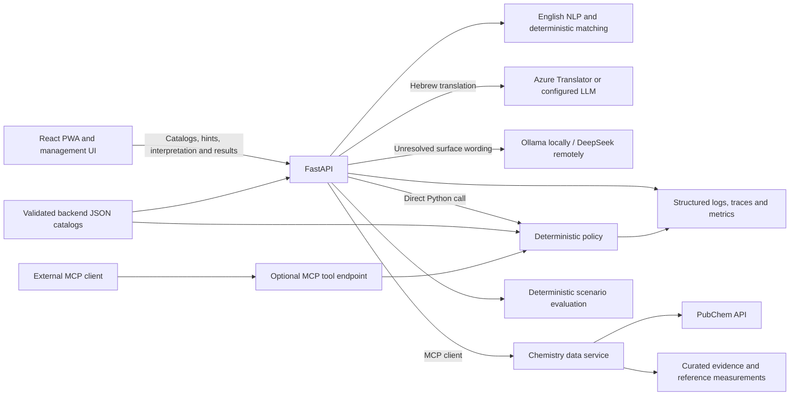

# HomeChem

HomeChem is an English/Hebrew household chemistry notebook with a React PWA and a FastAPI backend. The backend owns the catalogs, chemistry content, translations, matching rules, and calculations. React renders the content and actions returned by the API.

Cleaning questions follow an English NLP resolver, user confirmation, and deterministic assessment through a direct Python call. Reviewed procedures cover intact glass tabletops, smooth glass screens, and everyday cleaning of glazed ceramic sinks and tile floors. Each procedure includes instructions, chemistry reasoning, and sources.

Eight additional workspaces provide supported starter scenarios for stain removal, food science, limescale and corrosion, material care, water chemistry, home experiments, ingredient explanations, and chemical disposal. Water-hardness classification, experiment comparisons, and ingredient lookups run on the backend. These workspaces use explicit scenario selection; the free-text interpreter handles cleaning questions.

## Local development

Requirements are Python 3.12 through uv, Node 24, npm, and Ollama. Use an installed Ollama model or pull the model listed in `.env.example`.

```bash
scripts/bootstrap.sh
cp .env.example .env
scripts/dev.sh
```

Open [the local app](http://127.0.0.1:5173) and select **Try an example**. Hebrew questions are translated by the configured model before they enter the same English NLP resolver as English questions. Set `LLM_PROVIDER=fixture` in `.env` to use a stub for test translations and unresolved surface requests. Model names are configurable. To use dedicated machine translation, set `TRANSLATION_PROVIDER=azure`, `AZURE_TRANSLATOR_KEY`, and, for a regional resource, `AZURE_TRANSLATOR_REGION` in your local `.env` or VPS `runtime.env`. Azure only receives questions that need Hebrew translation. The default uses the configured LLM. The local smoke test was exercised with `qwen2.5:7b-instruct-q4_K_M`.

The development script starts the API on port 8000, the MCP data service on port 8002, and Vite on port 5173. Set `MCP_DATA_URL` to use another service implementing the same chemistry-data tools.

The PWA service worker runs in production builds and caches the app shell, static assets, and the most recently fetched backend presentation catalog for offline viewing. Interpretation, assessment, and scenario calculations require a connection. The locale preference is stored in versioned browser localStorage.

## Development commands

| Script | Purpose |
| --- | --- |
| `scripts/bootstrap.sh` | Install dependencies from the lockfiles and fetch WordNet |
| `scripts/download-nlp-data.sh` | Fetch the WordNet corpus for the English resolver |
| `scripts/dev.sh` | Run Vite, the API, and the MCP data service |
| `scripts/serve-knowledge.sh [port]` | Run the standalone MCP chemistry-data service |
| `scripts/knowledge-smoke.sh [mcp-url]` | Verify compound, evidence, and reference lookups through MCP |
| `scripts/generate-client.sh` | Regenerate frontend types from FastAPI’s OpenAPI schema |
| `scripts/check.sh` | Check schema drift and TypeScript |
| `scripts/test.sh` | Run Python tests; optional pytest arguments are forwarded |
| `scripts/install-browser.sh` | Install Chromium for browser tests |
| `scripts/browser-test.sh` | Build the PWA and run all browser tests against an isolated API with the fixture provider |
| `scripts/test-management.sh` | Check types, build, and test the management workflow |
| `scripts/test-use-cases.sh` | Check types, build, and test the scenario workspaces and calculators |
| `scripts/import-materials.sh <file>` | Validate and atomically apply a material catalog export |
| `scripts/import-procedures.sh <file>` | Validate and atomically apply a procedure catalog export |
| `scripts/provider-smoke.sh [base-url]` | Check English matching, live Hebrew translation, and the live surface fallback |
| `scripts/mcp-smoke.sh [mcp-url]` | Discover and call the policy from a standalone MCP client |
| `scripts/build.sh` | Build the React PWA. With a registry prefix and SHA, build both deployment images |

Browser tests launch their own API, fixture MCP data service, and preview server. The full suite uses API port 8011 and preview port 4173; management tests use 8012 and 4184; scenario tests use 8013 and 4183. To use an installed Chromium-compatible browser, set `PLAYWRIGHT_CHROMIUM_EXECUTABLE_PATH` to its executable.

## Architecture



- `web/src` contains presentation components, navigation, forms, keyboard interaction, language preference handling, and API types generated from OpenAPI. It renders backend-provided fields, instructions, and results.
- `backend/homechem` contains the FastAPI routes, NLP resolver, deterministic policy, scenario evaluators, MCP transport, provider adapters, and telemetry.
- `backend/homechem/data` holds the application definitions. The backend validates them at startup and derives matching rules, procedure eligibility, bilingual content, and hints from these definitions.
- `infra` contains the Dockerfiles, Caddy configuration, and Compose stack. Caddy serves the React assets and proxies the API and MCP endpoint over HTTPS.

| Backend catalog | Contents |
| --- | --- |
| `materials.json` | Material IDs, English/Hebrew labels, and English aliases |
| `procedures.json` | Object/material relationships, compatible finishes, cleaning supplies, bilingual confirmations and steps, chemistry reasoning, sources, and hints |
| `lexicon.json` | Object/device aliases, WordNet category roots, cleaning vocabulary, supply combinations, and exclusions |
| `scenarios.json` | Scenario content, input definitions, calculation parameters, and result explanations |
| `knowledge.json`, `research.json` | Cited evidence, reference measurements, and data-lab presentation definitions |
| `labels.json`, `messages.json`, `management_messages.json` | Display labels and interface translations |
| `guide.json`, `settings.json` | Algorithm guide and default example selection |

### API flow

1. `GET /api/catalog` supplies the content for the notebook, scenarios, and algorithm guide. `GET /api/hints` filters question suggestions on the server.
2. `POST /api/interpret` translates Hebrew when needed, then runs the shared English resolver. Its response includes recognized details, localized confirmation fields, and an assessment action when the backend finds a supported match.
3. After confirmation, `POST /api/assess` calls the instrumented Python assessment function directly. The response includes the decision, selected procedure content, sources, and policy version.
4. `POST /api/scenarios/{id}/evaluate` validates measurements or selections against the scenario definition and returns a localized result. Classification thresholds, ratios, and ingredient lookups run on the server.

English normalization uses NLTK stemming and WordNet categories. The LLM handles translation when configured and can suggest a surface for unresolved wording. Procedure approval comes from the deterministic policy.

The existing `/mcp` endpoint also exposes the assessment function to external clients. The web app uses the direct API-to-Python path. The backend also consumes chemistry data through a separate MCP data service.

### MCP data lab and activity traces

Select **Data lab** to use three tools:

- **Compound lookup** resolves an English compound name or CID through PubChem and returns identity, formula, molecular weight, and provenance.
- **Chemistry evidence** searches curated bilingual summaries about surfactants, water hardness, and emulsions, with links to their sources.
- **Experiment comparison** computes water density from measured mass and volume and compares it with a USGS reference at a selected temperature. The initial reference temperatures are 10, 21, and 26.7 °C.

The standalone data service publishes `lookup_compound`, `search_evidence`, and `get_reference`. The API validates MCP responses and caches successful results for one hour, up to 256 entries. PubChem lookup is live; evidence summaries and reference measurements are bundled, cited records. A retrieval timestamp records when the data service returned the record. Results can be exported as JSON for review.

Open **Activity trace** to watch recorded server operations while a request runs. The timeline shows model/provider metadata and token usage when available, NLP, policy evaluation, calculations, MCP calls, cache hits, failures, and duration. Expand a step to inspect its metadata and use the request and trace IDs to find the server logs.

The browser polls `GET /api/activities/{key}` using an unpredictable request capability key. Traces expire after ten minutes and the API retains at most 500 traces in memory. Raw prompts, credentials, and private model reasoning are excluded. The existing OpenTelemetry export remains available for persistent observability.

### Managing materials and procedures

Open **Management** at `/management` to inspect the active materials, dictionaries, procedure relationships, sources, scenario definitions, and resolution pipeline. The English resolver inspector runs the production matching logic and displays normalized tokens and extracted details.

1. Add a material with bilingual labels and English aliases, or edit an existing material in the draft JSON.
2. Validate and export the material catalog, then run `scripts/import-materials.sh <materials.json>`.
3. Edit the procedure definitions to specify the object, material, finishes, supplies, bilingual instructions, reasoning, and evidence. Validate and export, then run `scripts/import-procedures.sh <procedures.json>`.
4. Restart the API to load the catalogs. Commit the catalog files to include them in the GitHub Actions deployment.

Drafts remain in the page until exported. The import scripts validate before replacing files atomically. Materials referenced by procedures must remain in the catalog. Adding a procedure that uses existing algorithms requires catalog changes. New matching or calculation algorithms are implemented in the backend.

See [architecture](docs/architecture.md) for more detail, [technologies used](docs/technologies.md) for the stack, [terminology](docs/terminology.md) for normalization, and the [experiments](docs/experiments.md) and [home solutions](docs/home-solutions.md) catalogs for supported activities.

### Instrumentation and rate limits

Find a request by its ID in the structured API logs. Use the corresponding trace ID to follow the provider call or the policy assessment span. Local development exports spans to the console. Set `OTEL_EXPORTER_OTLP_ENDPOINT` and, if applicable, `OTEL_EXPORTER_OTLP_HEADERS` for production OTLP/HTTP traces and metrics. Model traces capture the provider, model, prompt version, and token counts where returned. Application logs omit prompts and credentials. Question submissions have a 10-second cooldown per IP. The guest inference budget separately defaults to 12 model requests per minute per API process and is configurable through `LLM_REQUESTS_PER_MINUTE`. Local test runs can set `QUESTION_COOLDOWN_SECONDS=0`. The production IP check assumes Caddy receives traffic directly and the API stays on the private Compose network.

## Production deployment

GitHub Actions runs checks on pull requests. On a successful push to `main`, it builds both images on a hosted runner, publishes them to GHCR, and deploys both immutable digests to the VPS. Compose runs the web, API, and private MCP data services; the data service reuses the API image. The deployed revision is recorded after the HTTPS smoke check verifies the PWA, expected API release, and direct policy assessment path. If the smoke check fails, deployment attempts to restore the previous pair. Use **Deploy → Run workflow** with a previously deployed commit SHA for manual rollback.

Once the repository exists:

1. Provision the Linux VPS with Docker Compose v2, Bash, curl, and jq. Create a deploy user with Docker access and a writable deployment directory, typically `/opt/homechem`.
2. Point the app domain at the VPS and allow inbound HTTPS, HTTP, and SSH as appropriate. Set `PUBLIC_HOST=your.domain` in the deployment directory’s `.env`.
3. Create `runtime.env` in that directory with `DEEPSEEK_API_KEY` and optional model, budget, and OTLP settings. Authenticate Docker on the VPS to GHCR if the packages are private.
4. In the GitHub `production` environment, configure `DEPLOY_HOST`, `DEPLOY_USER`, `DEPLOY_SSH_KEY`, and `DEPLOY_KNOWN_HOSTS` as secrets. Verify the VPS host key independently before setting known hosts. Set `DEPLOY_DIR` if it differs from `/opt/homechem`, or `DEPLOY_PLATFORM` if the server uses a platform besides `linux/amd64`.
5. After the first deployment, run `scripts/provider-smoke.sh https://your.domain` to exercise DeepSeek and `scripts/mcp-smoke.sh https://your.domain/mcp` to exercise the public, read-only tool.

The backend catalogs and evidence are bundled in the API image. Supabase-backed retrieval and the Molecule Explorer remain planned extensions.
