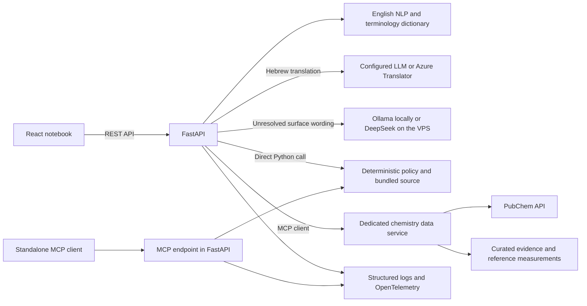

# HomeChem architecture

HomeChem is a bilingual household chemistry notebook. The current implementation covers intact glass tabletops, smooth glass screens, and everyday cleaning of glazed ceramic sinks and tile floors. A fifth procedure supports mechanical sink unclogging after explicit condition checks. Python resolves common terms through the [terminology dictionary](terminology.md). The user confirms the inputs, and Python determines whether the procedure applies.

The UI also includes eight bilingual scenario workspaces for stains, food science, limescale and corrosion, material care, water chemistry, home experiments, ingredient functions, and chemical disposal. Their supported starter scenarios, chemistry explanations, sources, input definitions, and calculation parameters live in `backend/homechem/data/scenarios.json`. They are selected explicitly from the navigation. FastAPI validates and evaluates measurements deterministically, and the client renders the returned result.

## Components

- The [React client](../web/src) owns the notebook workflow, shared components, and presentation of backend-provided translations. It sets the document direction for Hebrew RTL and stores the language preference in versioned `localStorage`. The [service worker](../web/service-worker.js) caches the app shell, static assets, and the most recently fetched backend presentation catalog for offline viewing. Assessments and scenario calculations require a connection.
- The [FastAPI service](../backend/homechem/main.py) validates REST requests and exposes the read-only `assess_cleaning` MCP tool. The REST assessment route calls the instrumented Python assessment function directly. Other MCP clients can call the same tool through `/mcp`.
- The [provider adapters](../backend/homechem/providers.py) share typed translation and surface suggestion contracts. Backend settings select local Ollama, hosted DeepSeek, or the fixture provider used in tests.
- The [policy module](../backend/homechem/policy.py) owns the decision, rule ID, policy version, and source. The browser renders the corresponding reviewed instructions and the chemistry or physical mechanism from the backend response.

## Fix-It request flow

1. `POST /api/interpret` translates Hebrew questions into English with the configured provider. It then resolves object, substrate, finish, and cleaning materials in Python using the same English rules for every request. English questions with recognizable terms or exclusions bypass inference. After normalization, a shared MCP evidence search runs before any surface-model fallback. For unfamiliar surface wording, the configured provider can suggest a surface. Materials stay unverified on that path.
2. When the inputs match the reviewed scope, the notebook asks the user to confirm the surface and materials. Confirmation sends the structured inputs to `POST /api/assess`.
3. The API calls the instrumented `assess_cleaning` Python function directly. The policy returns `approved` only for confirmed inputs matching the reviewed material, finish, use context, and cleaning supplies. Device names appear as recognized context and are absent from the policy inputs. Other inputs yield `unverified`.
4. The notebook shows the result and supporting evidence. Interpretation and assessment each have a request ID. The browser console logs a structured summary for each API attempt with the original question, timing, outcome, and request ID. The assessment request contains a policy evaluation span. The optional MCP endpoint calls the same instrumented function for external clients.

## Runtime and deployment

Locally, [the development script](../scripts/dev.sh) starts Vite, the API, and the dedicated MCP data service on port 8002. Vite proxies API calls to the backend, which defaults to Ollama at `127.0.0.1:11434`.

The [production stack](../infra/compose.yaml) targets a single 4 GB VPS. Caddy serves the built PWA and proxies `/api/*` and `/mcp` to one FastAPI worker. A private `knowledge` service reuses the API image and exposes the chemistry-data MCP tools to the API. DeepSeek generates structured interpretations remotely. The [deployment workflow](../.github/workflows/deploy.yml) builds the web and API images on GitHub-hosted runners, publishes them to GHCR, and deploys the paired image digests over SSH. The deploy script verifies the HTTPS app shell, release SHA, and assessment flow before recording the release. A failed smoke check triggers an attempt to restore the previous pair.

The API writes structured logs with request IDs, trace IDs, and the deployed release SHA. Local development exports spans to the console. The production service can export traces and metrics over OTLP/HTTP. Server telemetry records timings and decision metadata and omits raw prompts and credentials.

The API accepts one new question per IP every 10 seconds. The cooldown applies to `POST /api/interpret` before dictionary resolution or inference. Confirmation, health checks, and MCP tool calls use their own routes. Caddy overwrites the upstream client-IP header with the address of its direct peer, and the production API accepts that header on the private Compose network. The per-IP cooldown and the separate process-wide LLM budget use in-memory state in the single API worker. Both limits respond with HTTP 429 and `Retry-After`.

## Planned extensions

Supabase Postgres is planned for evidence retrieval, inventory, and compound lookup caching. The current procedures use bundled evidence. The Molecule Explorer is planned to use a model trained offline for aqueous solubility prediction, with its own evaluation and display. User preferences are browser-local in the current phase.

Update this document when request flow, component boundaries, persistence, or deployment changes. See [technologies used](technologies.md) for the implementation stack.

## Catalog management

Open `/management` through the Management link. The bilingual page reads the active backend catalog, shows procedure relationships and sources, exposes runtime dictionaries and the resolution pipeline, and runs English examples through the production deterministic resolver. The additional scenario catalog is visible in the same page.

Surface material definitions live in `backend/homechem/data/materials.json`. Each entry contains a stable ID, English and Hebrew labels, English aliases, optional parent IDs, and optional source identifiers. Parent IDs must exist and the graph must be acyclic. Specific identity is retained (porcelain → ceramic), while reviewed surface matching can use explicitly declared ancestry. The backend validates and compiles these entries at startup. The consumer UI reads their labels from the API, so adding a recognized material does not require a frontend label change.

To add a material, use the form or edit the draft JSON, then choose Validate & export catalog. Apply the downloaded file with `./scripts/import-materials.sh <materials.json>`, restart the local API, and commit the catalog change for GitHub Actions deployment. Deployment rebuilds the API image with the catalog. Drafts remain in browser memory until export. The management API exposes read, validation, and deterministic inspection endpoints. Application of catalog changes happens through the repository script.

Validation rejects duplicate IDs, conflicting normalized aliases, empty labels, and malformed entries. The validation endpoint and import script also protect materials referenced by reviewed procedures. The importer validates before replacing the file atomically. Recognizing a new material does not introduce a procedure. Procedures are also catalog data. Add an object/material relationship, finishes, supply combination, bilingual confirmation and instructions, chemistry reasoning, and evidence in `procedures.json`. Matching, provider options, approval, hints, and UI content derive from that definition. New algorithm types are implemented in the backend.

Run `./scripts/test-management.sh` for the browser workflow and `./scripts/test.sh tests` for backend checks. The browser script uses separate API and preview ports to coexist with local development.

## Backend-owned application definitions

The frontend handles rendering, navigation, keyboard interaction, network requests, and user preferences. Chemistry content and decisions come from the backend.

| Backend file | Owns |
| --- | --- |
| `data/materials.json` | Surface-material IDs, bilingual labels, English aliases |
| `data/procedures.json` | Object/material relationships, finishes, supplies, bilingual steps and confirmations, reasoning, sources, hints |
| `data/lexicon.json` | Object and device aliases, WordNet category roots, cleaning supplies, supply combinations, exclusions and question vocabulary |
| `data/scenarios.json` | Scenario content, input schemas, calculator parameters and result explanations |
| `data/knowledge.json`, `data/research.json` | Curated evidence, reference measurements, and data-lab interface definitions |
| `data/labels.json`, `data/messages.json`, `data/management_messages.json` | Display labels and interface translations |
| `data/guide.json`, `data/settings.json` | Algorithm guide and default example selection |

The backend validates these definitions at startup. `GET /api/catalog` supplies the presentation content, and `GET /api/hints` selects matching suggestions. Interpretation responses include localized fields and an optional assessment action selected by the backend. Assessment responses include the selected procedure content. React renders these without maintaining a surface-to-procedure map.

`POST /api/scenarios/{id}/evaluate` validates values against the scenario's input definitions and evaluates the configured classification, ratio, or lookup algorithm. Numeric inputs must be finite and meet their declared minimum. The API returns the localized result and the normal request instrumentation applies.

Management exposes procedure JSON editing with backend validation and export. Apply with `./scripts/import-procedures.sh <procedures.json>`, restart the API, and commit the data for deployment. Material and procedure imports replace their files atomically after validation. A backend integration test adds a surface through JSON alone and verifies recognition, confirmation, assessment, and returned instructions.

The public API keeps its existing interpretation and assessment fields and adds presentation content. Surface and supply IDs are strings so catalog additions can flow through the existing API and generic React components.

## MCP data consumption

The Data lab uses the backend as an MCP client. `knowledge_client.py` calls a standalone service selected through `MCP_DATA_URL`. The default local service runs on port 8002; production uses `http://knowledge:8000/mcp` on the private Compose network.

| MCP tool | Data source and result |
| --- | --- |
| `lookup_compound` | Live PubChem PUG REST lookup by English name or CID; identity, formula, molecular weight, source URL |
| `search_evidence` | Keyword search over curated bilingual source summaries about surfactants, water hardness, emulsions, and drain chemistry |
| `get_reference` | Cited USGS water-density values at 10, 21, and 26.7 °C, with units and conditions |

Typed responses carry provenance, retrieval time, and a live/curated/fixture marker. The timestamp refers to retrieval through the service. It does not imply that a curated source was fetched or reviewed live. Successful MCP responses are validated and cached for an hour, with a limit of 256 entries. Errors are not cached. Calls have a 25-second overall deadline.

The experiment comparison validates mass and volume in the API, retrieves the selected temperature-specific reference through MCP, and calculates measured density and signed relative difference. The UI renders the result and source. There is no interpolation or statistical-significance claim.

The data service is independently runnable with `scripts/serve-knowledge.sh` and testable with `scripts/knowledge-smoke.sh`. Browser tests launch it in fixture mode, which explicitly marks compound test records and does not contact PubChem. The existing public assessment MCP endpoint remains available separately.

## Client-visible activity traces

`activities.py` maintains request-scoped operation records using context variables. The same operation context creates the OpenTelemetry span and updates the client-visible record, avoiding duplicate instrumentation. Model calls, Azure translation, NLP, policy evaluation, scenario calculations, MCP retrieval, reference comparison, and cache hits are instrumented.

The client assigns an unpredictable capability key to each tracked request through `X-Activity-Key`. The API registers the collection before processing, returns the key through `X-Activity-ID`, and serves live snapshots from `GET /api/activities/{key}`. The timeline polls every 450 ms while the request is pending and fetches a final snapshot on completion. Each record has an ID, optional parent ID, kind, status, start offset, duration, and operation metadata.

Snapshots include the request ID and the corresponding OpenTelemetry trace ID. Client-visible debug sections can include normalized submitted terms and MCP queries. These debug sections are excluded from structured server logs and OpenTelemetry attributes. Model prompts, credentials, and private model reasoning are omitted. Completed and running traces expire after ten minutes; storage is bounded to 500 traces and 100 recorded operations per request. Server telemetry export can provide longer retention.

## Shared implementation boundaries

`presentation.py` defines the input and display-field schemas used by both scenarios and research tools. Reference choices are derived from the reference dataset; numeric and text constraints for research forms come from the backend input models. Management uses an explicit OpenAPI response model and the active in-memory catalog snapshot.

The React `InputFields` component renders those definitions. `api.ts` centralizes JSON response parsing, request errors, retry metadata, and attempt logging. `download.ts` owns JSON exports. Client code contains presentation and interaction behavior.

Both catalog-import Bash commands delegate to `catalog_import.py`, which shares reference validation and atomic writes. Existing procedure objects are indexed for assessment and presentation instead of being copied into parallel tuple/content maps. TypeScript checks reject unused local declarations and parameters.

## Evidence across chemistry workflows

The shared `evidence.py` stage connects cleaning interpretation, REST assessment, scenario exploration, scenario calculations, and the English management resolver inspector to MCP evidence search. The Data lab continues to call the selected compound, evidence, or reference tool directly.

Interpretation searches with the English question after normalization and before any model fallback. REST assessment evaluates the local policy directly, then supplements its result with evidence for the selected procedure. Opening a scenario requests its evidence through `POST /api/scenarios/{id}/evidence`; evaluation responses include the same evidence context. The inspection endpoint returns evidence alongside deterministic resolver output.

The evidence context contains a `matched`, `no_matches`, or `unavailable` status, bilingual explanation, and source records. Supplemental searches have a four-second budget and use the MCP client's existing cache. Each search records its outcome and source count in the activity trace. Failure to retrieve supplemental evidence does not change the local policy decision.

Interpretation also returns `resolution_status` separately from HTTP success. A question can return HTTP 200 while reporting `unresolved` and `no_matches`. The Mac keyboard regression now recognizes the object locally and reports `needs_details` because the exposed material is unstated. Finding a related source cannot supply missing material evidence or create a reviewed procedure automatically. Health checks, catalog loading, schema validation, and preference changes remain local operations.

## Resolution diagnostics

The production resolver returns a structured diagnostic record built from its actual matches and decisions. It includes normalized tokens, noun lemmas, object/category/device/material/finish/supply matches, unmatched tokens, phrase linking, candidate surface, fallback eligibility, and reason codes. Interpretation adds final evidence and model outcomes.

The normalization activity exposes input-derived debugging fields separately from exported metadata. The evidence step records the provider-reported search method and document count, query truncation, match count, source IDs, budget, and failure type. Input-derived search terms and the MCP query are client-visible debug fields. Model output diagnostics describe the validated surface result and allowed catalog options.

The server adds `X-Trace-ID` alongside `X-Request-ID` and `X-Activity-ID`. Console summaries include these correlation values and an activity URL. HTTP success and resolution status retain separate meanings.

### Entity resolution and terminology sources

`entities.py` loads the locked small English spaCy model once per API process. Dependency parsing extracts grammatical cleaning targets and their modifiers. WordNet classifies physical objects under the roots in `data/entities.json`; all matching sense IDs and only common ancestors are retained rather than claiming word-sense disambiguation. Generic heads such as “surface” remain eligible for the existing constrained fallback. The local lexicon handles application categories, supplies, restrictions, and precise overrides. It need not list every object noun. No object category implies a material.

Material records remain the local identity and policy overlay. `material_lineage()` preserves subtype IDs and traverses explicit parent links for surface matching. `knowledge.json` owns cited evidence/reference records; it is not an alternative material registry. `knowledge_server.py` serves those records and live PubChem data rather than duplicating normalization.

`terminology.py` uses the reusable MCP adapter to call `searchClasses` on the official OLS service, filtered to ChEBI. The adapter validates either structured MCP output or a single JSON text block and caches validated results for one hour (256 per client). Unknown substance modifiers can request up to two supplementary lookups with a five-second budget each. No results or an unavailable endpoint leave deterministic interpretation intact. Explicit Data lab searches return a 503 when unavailable. Ontology candidates remain separate from catalog identities and do not modify procedure eligibility. Activity traces include the provider, tool, outcomes, and candidate IDs; input-derived queries stay in client debug metadata.

### Portable debug bundles

`debug_bundle.py` captures bounded API input/output JSON, request-scoped structured `telemetry.event()` records, and outbound HTTP method/URL/status/duration via shared httpx hooks. The private MCP client's factory installs the same hooks. Tool arguments remain in sanitized activity metadata. A response iterator wrapper captures the API response without consuming it or changing its body. JSON key redaction removes credential-like fields; request authentication headers are never retained.

`GET /api/activities/{key}/download` validates the existing expiring capability and returns a standard-library ZIP for a completed attempt (409 while running, 404 if missing/expired). The archive holds a manifest, trace snapshot, request records, and JSONL application logs. Limits are 32 KiB per JSON body, 30 request records, and 100 log events, within the existing 500-trace/ten-minute retention. It does not read global log files or retrieve remote process logs.

### External object-to-material candidates

`ObjectMaterialClient` in `object_materials.py` provides a common free-API adapter for Wikidata and DBpedia. spaCy preserves product modifiers and separates an attached “of” owner from its component without a vendor-name dictionary. `Resolution.object_query` and `requested_component` drive automatic enrichment only when a unique object has no stated substrate. Interpretation, management inspection, and the generic Data lab use the same adapter.

Each provider has a six-second total deadline; calls run concurrently. Valid empty results and explicit claims are cached for one hour, up to 128 queries per provider; unavailable results are not cached. Wikidata uses `wbsearchentities` plus batched `wbgetentities`, retaining material IDs, applies-to-part qualifiers, and source references. DBpedia uses an exact-English-label SPARQL query and explicit material predicates. Claims remain attached to their originating entity and provider. Neither source assigns a substrate, finish, or reviewed procedure automatically. APIs may identify an entity while lacking its composition. `OBJECT_DATA_MODE=fixture` isolates browser tests and labels outputs as fixtures; production defaults to live.

### Task-specific procedures and required conditions

Procedure targets now include `intent` (`clean` by default). `lexicon.json.task_verbs` defines additional English task aliases; explicit non-clean tasks take precedence over generic cleaning words. `REVIEWED_TARGETS` indexes intent/object/material. `REVIEWED_SURFACES` remains restricted to surface cleaning for constrained model suggestions, so a model cannot select the unclogging procedure.

An explicit `material: null` is allowed only for non-clean tasks. The sink-drain mechanical procedure therefore does not infer a basin material. Catalog `checks` supply bilingual condition labels; `ReviewView.checks` localizes them and the UI submits Boolean values. `AssessmentInput` adds `intent` and strict Boolean `checks`; policy rejects an intent mismatch or any missing/false required condition. Previous procedures retain their default clean intent and empty check list. Catalog `blocked_terms` matches withhold procedure selection and return `content.blocked_reason`; the detector treats mentions conservatively, including negated mentions.

Unclogging has positive and blocked-input backend tests, English sanity coverage, and Hebrew browser coverage through the shared translated-English resolver. Four curated MCP evidence topics now include drain chemistry.

### Problem nouns and affected objects

`entities.json.problem_task_roles` defines task-specific WordNet patient roots, action lemmas, and location prepositions. `nlp.task_roles` parses once and can infer an unclogging intent from an action plus an obstruction-class patient. Target extraction then maps an attached location (for example, “a clog in the sink”) to the affected object rather than classifying the obstruction as a competing object. Only the problem head and connecting preposition are excluded from remaining-word checks, by normalized token position; modifiers, extra fixtures, and chemical exclusions remain visible. The activity trace records inferred intents and problem nouns.

Debug JSON redaction preserves diagnostic NLP token lists and numeric token-usage counts, while credential token fields and token-bearing URL parameters remain redacted.
