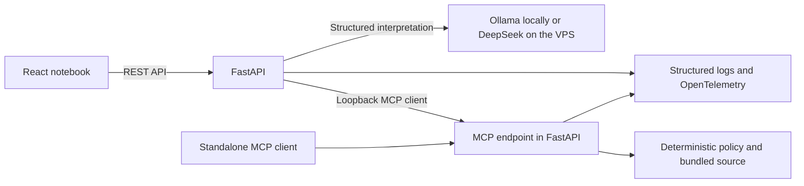

# HomeChem architecture

HomeChem is a bilingual household chemistry notebook. The current implementation covers one reviewed Fix-It procedure for standard-glass Apple Studio Displays using water and a microfiber cloth. The model interprets the question. The user confirms the inputs, and Python determines whether the procedure applies.

## Components

- The [React client](../web/src) owns the notebook workflow, shared components, and language catalogs. It sets the document direction for Hebrew RTL and stores the language preference in versioned `localStorage`. The [service worker](../web/service-worker.js) caches the app shell and static assets. Assessments require a connection.
- The [FastAPI service](../backend/homechem/main.py) validates REST requests and exposes the read-only `assess_cleaning` MCP tool. The REST assessment route calls that tool over loopback HTTP. Other MCP clients can call the same tool through `/mcp`.
- The [provider adapters](../backend/homechem/providers.py) share a typed interpretation contract. Backend settings select local Ollama, hosted DeepSeek, or the fixture provider used in tests.
- The [policy module](../backend/homechem/policy.py) owns the decision, rule ID, policy version, and source. The browser renders the corresponding reviewed instructions and explanation from its language catalog.

## Fix-It request flow

1. `POST /api/interpret` sends the question to the configured provider and validates the structured result. Unknown surfaces or materials appear as unverified in the notebook.
2. When the inputs match the reviewed scope, the notebook asks the user to confirm the surface and materials. Confirmation sends the structured inputs to `POST /api/assess`.
3. The API calls `assess_cleaning`. The policy returns `approved` only for confirmed inputs matching the reviewed scope. Other inputs yield `unverified`.
4. The notebook shows the result and supporting evidence. Interpretation and assessment each have a request ID. The assessment trace continues through the loopback MCP call to policy evaluation.

## Runtime and deployment

Locally, [the development script](../scripts/dev.sh) starts Vite and Uvicorn. Vite proxies API calls to the backend, which defaults to Ollama at `127.0.0.1:11434`.

The [production stack](../infra/compose.yaml) targets a single 4 GB VPS. Caddy serves the built PWA and proxies `/api/*` and `/mcp` to one FastAPI worker. DeepSeek generates structured interpretations remotely. The [deployment workflow](../.github/workflows/deploy.yml) builds the web and API images on GitHub-hosted runners, publishes them to GHCR, and deploys the paired image digests over SSH. The deploy script verifies the HTTPS app shell, release SHA, and assessment flow before recording the release. A failed smoke check triggers an attempt to restore the previous pair.

The API writes structured logs with request IDs, trace IDs, and the deployed release SHA. Local development exports spans to the console. The production service can export traces and metrics over OTLP/HTTP. Application telemetry records timings and decision metadata and omits raw prompts and credentials.

## Planned extensions

Supabase Postgres is planned for evidence retrieval, inventory, and compound lookup caching. The first procedure uses bundled evidence. The Molecule Explorer is planned to use a model trained offline for aqueous solubility prediction, with its own evaluation and display. User preferences are browser-local in the current phase.

Update this document when request flow, component boundaries, persistence, or deployment changes. See [technologies used](technologies.md) for the implementation stack.
