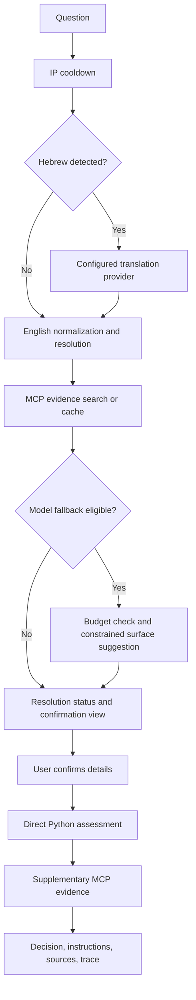

# HomeChem terms and processes inventory

Verified against the implementation on 2026-11-21. This document inventories the current system. Update it when catalogs, schemas, workflows, or ownership change.

## Ownership and source locations

The backend owns chemistry data, terminology, validation, decisions, translations, and calculations. React renders backend content, collects input, handles navigation and keyboard interaction, and stores the language preference locally.

### JSON catalogs and remote calls

The current implementation adds remote lookups alongside local JSON catalogs; it has not replaced those catalogs with MCP calls. MCP describes how data is accessed, and does not by itself determine where that data is stored.

| Data | Current source and access |
| --- | --- |
| Reviewed materials, aliases, procedures, fact requirements, scenarios, and UI text | Local JSON loaded by the API; these still drive deterministic resolution and approval |
| Chemical terminology candidates | Official OLS MCP `searchClasses` calls against ChEBI; supplementary results are not imported into the reviewed material catalog |
| Compound records | HomeChem MCP `lookup_compound`, backed by live PubChem requests (fixtures in tests) |
| Evidence summaries and reference measurements | HomeChem MCP `search_evidence` and `get_reference`; the MCP service itself still reads bundled `knowledge.json` |
| Object/product material claims | Direct Wikidata and DBpedia HTTP APIs, not MCP; supplementary claims do not set the reviewed substrate |

Replacing the remaining JSON catalogs with remote sources would require additional implementation. In particular, external terminology and material claims currently cannot create reviewed procedures or authorize an assessment.

All paths in the tables are relative to the repository root. Catalog files reside in [backend/homechem/data](../backend/homechem/data). Python schemas and functions are authoritative for validation and behavior. [web/src/schema.d.ts](../web/src/schema.d.ts) is generated from OpenAPI.

| Definition | Source | Loader, validator, or consumer |
| --- | --- | --- |
| Material identities, aliases, bilingual names | [materials.json](../backend/homechem/data/materials.json) | `MaterialDefinition`, `MaterialCatalog`, `load_materials()` in [catalog.py](../backend/homechem/catalog.py) |
| Object, device, finish, supply, and language-matching vocabulary | [lexicon.json](../backend/homechem/data/lexicon.json) | [lexicon.py](../backend/homechem/lexicon.py) builds runtime dictionaries; [interpretation.py](../backend/homechem/interpretation.py) compiles and matches aliases |
| Reviewed cleaning procedures and eligibility | [procedures.json](../backend/homechem/data/procedures.json) | `ProcedureCatalog` in [definitions.py](../backend/homechem/definitions.py); [policy.py](../backend/homechem/policy.py) evaluates confirmed inputs |
| Scenario content, inputs, calculation parameters | [scenarios.json](../backend/homechem/data/scenarios.json) | `ScenarioDefinition`, `calculate_scenario()` in [application.py](../backend/homechem/application.py) |
| Curated evidence, reference measurements, search stop words | [knowledge.json](../backend/homechem/data/knowledge.json) | [knowledge_server.py](../backend/homechem/knowledge_server.py) exposes MCP tools; [knowledge_models.py](../backend/homechem/knowledge_models.py) defines result contracts |
| Research forms, descriptions, result labels | [research.json](../backend/homechem/data/research.json) | [research.py](../backend/homechem/research.py) derives input constraints from Pydantic models and reference options from `knowledge.json` |
| Entity labels and unsupported-scope explanations | [labels.json](../backend/homechem/data/labels.json) | `review_view()` in [application.py](../backend/homechem/application.py) builds localized confirmation fields |
| Application UI and evidence messages | [messages.json](../backend/homechem/data/messages.json) | `ApplicationCatalog`; shared [evidence.py](../backend/homechem/evidence.py) |
| Management UI copy | [management_messages.json](../backend/homechem/data/management_messages.json) | `ApplicationCatalog`; [Management.tsx](../web/src/Management.tsx) |
| How-it-works page | [guide.json](../backend/homechem/data/guide.json) | `GuideView`; [HowItWorks.tsx](../web/src/HowItWorks.tsx) |
| Default example procedure | [settings.json](../backend/homechem/data/settings.json) | `example_procedure` references a procedure ID; `ProcedureCatalog` requires it to remain present |
| Shared input and display schemas | [presentation.py](../backend/homechem/presentation.py) | `InputField`, `InputOption`, `DisplayField`, `Language`, `Text`; [InputFields.tsx](../web/src/InputFields.tsx) renders forms |
| Model prompts and output constraints | [providers.py](../backend/homechem/providers.py) | `PROMPT`, `TRANSLATION_PROMPT`, `SurfaceSuggestion`, `EnglishTranslation`, `ModelProvider` |
| Policy and prompt versions | [policy.py](../backend/homechem/policy.py), [providers.py](../backend/homechem/providers.py) | `POLICY_VERSION`, `PROMPT_VERSION`, and the translation prompt version passed to `_complete()` |

Most runtime catalogs are loaded when the API process imports its modules. Restart the API after applying changes. The separate MCP data service also loads its own data at startup and needs a restart after changes to `knowledge.json`.

## Core terms and interpretation data dictionary

These fields are defined by `Interpretation` in [policy.py](../backend/homechem/policy.py), `InterpretResult` in [main.py](../backend/homechem/main.py), and `Resolution` in [interpretation.py](../backend/homechem/interpretation.py).

| Field | Meaning | Examples and behavior |
| --- | --- | --- |
| `object_type` | Object or recognized category being cleaned | `sink`, `floor`, `screen`, `cutlery`; `null` when a unique object cannot be resolved |
| `device` | Device context associated with an object | `laptop`, `macbook`, `ipad`; a device name alone does not establish the exposed material |
| `substrate` | Material of the exposed surface | `ceramic`, `glass`, `stainless_steel` |
| `finish` | Stated treatment, coating, or surface condition category | `glazed`, `uncoated`, `nano_texture`; `null` means unspecified or ambiguous |
| `materials` | Cleaning supplies/tools resolved to a supported combination ID | `water_and_mop_only`; `not_stated` means no supplies were identified and the remaining wording is understood; `unknown` means supplies are unverified |
| `surface` | Reviewed surface ID used for procedure selection | `ceramic_sink`, `glass_tabletop`, `unknown` |
| `surface_term` | Display-oriented recognized surface/object/material identifier | Can exist while `surface` is `unknown`; it does not confer procedure approval |
| `method` | Interpretation path | `dictionary` or `model`; this is independent of evidence-retrieval status |
| `originalText` | Exact browser-submitted text retained in the console summary | The API input field is `text`; the original text is separate from any translation |
| `translated_text` | English translation used by the resolver | `null` for English input |
| `translation_provider` | Provider selected for Hebrew translation | `llm`, `azure`, or `null` |
| `resolution_status` | Whether interpretation can proceed to confirmation | See the status dictionary below |
| `presentation` | Backend-built views keyed by language | Localized fields, confirmation text, button label, and an optional assessment payload |
| `evidence` | Supplementary MCP evidence context | Status, explanation, source records, and provider-reported search metadata |
| `entities` | Source-linked object/material identities | `EntityReference`: id, kind, label, source, classes, sense_ids, modifiers, external_ids |
| `terminology` | Supplementary ChEBI candidate result sets | Official OLS results; candidates do not establish substrate or policy approval |
| `diagnostics` | Resolver observations and final reason codes | Used by the console, management inspector, and activity trace |

`material` in a procedure definition references a substrate ID. `supplies` references a cleaning-supply combination. The interpretation field named `materials` carries that supply combination, which can otherwise be confused with `substrate`.

### Current vocabulary coverage

This snapshot lists canonical IDs. Aliases and generated WordNet terms are available in Management and the source catalogs.

| Group | Current entries | Definition and expansion |
| --- | --- | --- |
| Substrates, 12 | `ceramic`, `glass`, `stainless_steel`, `natural_stone`, `wood`, `laminate`, `vinyl`, `concrete`, `porcelain`, `fireclay`, `marble`, `granite` | `materials.json`; each entry supplies English aliases and English/Hebrew labels |
| Objects, 13 | `tabletop`, `sink`, `screen`, `shower`, `window`, `mirror`, `countertop`, `tile`, `bathtub`, `toilet`, `oven`, `cooktop`, `floor` | `lexicon.json.objects` maps each ID to aliases |
| WordNet categories, 1 | `cutlery` | `lexicon.json.object_categories` maps to `cutlery.n.02`; `category_terms()` expands the sense and its hyponyms |
| Devices, 8 | `studio_display`, `iphone`, `iphone_duo`, `ipad`, `android`, `macbook`, `phone`, `laptop` | `lexicon.json.devices`; recognized context is retained separately from material |
| Finishes, 9 | `screen_protector`, `standard_glass`, `glazed`, `uncoated`, `unglazed`, `nano_texture`, `coated`, `polished`, `frosted` | `lexicon.json.finishes`; acceptable finishes come from each procedure |
| Supply terms, 8 | `mop`, `water`, `microfiber`, `dry_microfiber`, `soft_cloth`, `dish_soap`, `other`, `plunger` | `lexicon.json.cleaning_supplies`; `other` recognizes supplies outside the reviewed combinations |
| Damage exclusions, 4 | `cracked`, `chipped`, `broken`, `damaged` | `lexicon.json.exclusions` prevents a reviewed surface match from being approved by interpretation |
| Cleaning vocabulary | Verb aliases and accepted question words | `lexicon.json.cleaning_verbs` and `question_words`; normalized before matching |
| Descriptive surface aliases, 2 | Stainless-steel sink and shower glass display IDs | `lexicon.json.surface_descriptions`; these descriptions do not add reviewed procedures |

Previously unlisted physical objects such as `keyboard`, `saucepan`, and `curtain` can be recognized through spaCy target extraction and WordNet classes. `mac` remains an unmatched modifier; it does not determine a material. The keyboard regression now exercises `needs_details`, no model fallback, supplementary MCP evidence lookup, and explicit diagnostics.

### Supported supply combinations

`lexicon.json.supply_combinations` defines complete sets. `MATERIAL_SETS` in `interpretation.py` compiles them to unordered sets.

| Combination ID | Required recognized supply IDs |
| --- | --- |
| `cup_plunger_and_water` | `plunger`, optionally stated with `water`; the required setup check confirms the remaining equipment |
| `dry_microfiber_only` | `dry_microfiber` |
| `water_and_microfiber_only` | `water`, `microfiber` |
| `water_and_mop_only` | `water`, `mop` |
| `mild_dish_soap_water_and_soft_cloth` | `water`, `dish_soap`, and either `soft_cloth` or `microfiber` |

Unexplained remaining words or an unsupported supply set produce `materials = unknown`.

## Catalog record dictionaries

### Material record

Defined by `MaterialDefinition` and `MaterialCatalog` in [catalog.py](../backend/homechem/catalog.py).

| Field or rule | Definition |
| --- | --- |
| `id` | Unique lowercase identifier matching `^[a-z][a-z0-9_]{0,63}$` |
| `labels.en`, `labels.he` | Required nonblank names, each 1–100 characters |
| `aliases` | 1–50 English/ASCII phrases; each must normalize to tokens and be at most 100 characters |
| `parents` | Optional explicit material parent IDs; unique, existing, and acyclic |
| `external_ids` | Optional source identifier mapping retained with the material entity |
| Catalog validation | 1–500 materials; duplicate IDs and normalized aliases shared by different materials are rejected |
| Reference validation | Imports and Management validation reject removal of materials referenced by current procedures |

### Procedure record

Defined by `ProcedureDefinition`, `ProcedureContent`, `EvidenceSource`, and `ProcedureCatalog` in [definitions.py](../backend/homechem/definitions.py).

| Field | Definition |
| --- | --- |
| `id` | Unique rule/procedure ID matching `^[a-z][a-z0-9_]+$` |
| `surface` | Unique reviewed surface ID matching `^[a-z][a-z0-9_]+$`; `unknown` is reserved |
| `object` | Canonical ID present in `lexicon.json.objects` |
| `intent` | Task ID; defaults to `clean`, with additional aliases in `task_verbs` |
| `material` | Existing material ID; null is permitted for non-clean mechanical tasks |
| `checks` | Required condition IDs and bilingual labels; each must be confirmed true or satisfied by a linked known fact |
| `requirements` | Fact predicates, expected string/Boolean values, optional linked check IDs, and bilingual clarification questions; conflicting scoped facts exclude the procedure |
| `finishes` | Allowed finish IDs; `null` explicitly permits an unspecified finish |
| `supplies` | Existing supply-combination ID |
| `source` | Required procedure citation with `title`, HTTPS `url`, and `language` (`en` or `he`) |
| `chemistry_source` | Optional citation with the same shape |
| `content.en`, `content.he` | Required localized procedure content |
| `content.*.title` | Surface/procedure title |
| `content.*.confirmation` | Details the user must confirm |
| `content.*.accept` | Action label when supplies were unspecified |
| `content.*.steps` | Nonempty ordered list of instructions |
| `content.*.why` | Chemistry or physical explanation |
| `content.*.hint` | Full question used in autocomplete; also supplies examples |
| Catalog constraints | 1–500 entries; IDs, surfaces, and intent/object/material targets must be unique; referenced objects, materials, supplies, finishes, and default example must exist |

Category recognition alone does not satisfy the current procedure validator's object check. A procedure object must also be registered in `lexicon.json.objects`.

| Current rule ID | Surface ID | Object/material | Supply combination |
| --- | --- | --- | --- |
| `ceramic_sink_dish_soap_cleaning` | `ceramic_sink` | `sink` / `ceramic` | `mild_dish_soap_water_and_soft_cloth` |
| `glass_table_water_cleaning` | `glass_tabletop` | `tabletop` / `glass` | `water_and_microfiber_only` |
| `sink_drain_mechanical_unclogging` | `sink_drain` | `unclog` / sink; material-independent | `cup_plunger_and_water` |
| `glass_screen_dry_cleaning` | `glass_screen` | `screen` / `glass` | `dry_microfiber_only` |
| `ceramic_floor_water_mopping` | `ceramic_tile_floor` | `floor` / `ceramic` | `water_and_mop_only` |

`PROCEDURES` indexes the validated records by `(surface, supplies)`. `PROCEDURES_BY_SURFACE` indexes the same definitions for presentation. The historical `Surface` and `Materials` enum constants in `policy.py` are named identifiers; API fields accept string IDs so catalog extensions can use the generic flow.

### Scenario and shared form records

Defined in [application.py](../backend/homechem/application.py) and [presentation.py](../backend/homechem/presentation.py).

| Field | Definition |
| --- | --- |
| `id` | Unique scenario ID |
| `title`, `example`, `why`, `submit` | English/Hebrew text maps |
| `steps` | English/Hebrew ordered instruction lists |
| `source` | Citation with `title` and `url` |
| `fields` | Form inputs with unique IDs |
| `calculation` | `null`, `classification`, `ratio`, or `lookup`; validated against declared fields |
| `InputField.id`, `label`, `kind` | Input name, localized label, and `text`, `number`, or `select` kind |
| `InputField.minimum`, `maximum`, `max_length` | Optional form constraints; scenario evaluation enforces finite numbers/minimum and select membership; research input models enforce their declared bounds |
| `InputField.options` | Select choices shaped as `id` plus localized `label` |
| `DisplayField` | Localized, already-prepared `label` and `value` rendered by React |

| Scenario ID | Implemented process |
| --- | --- |
| `stains` | Fresh coffee on washable cotton guidance |
| `food` | Oil-and-water separation explanation |
| `scale` | Heated-water deposits and corrosion distinction |
| `materials` | Acidic-food container compatibility considerations |
| `water` | Hardness classification from mg/L as CaCO₃ |
| `experiments` | Unstirred/stirred dissolving-time ratio |
| `labels` | Ingredient-class explanation lookup |
| `disposal` | Leftover-paint handling and local disposal referral |

Classification uses ordered thresholds and a result per interval, with boundaries included in the lower interval. Ratio definitions reference numeric numerator and denominator fields with a positive denominator minimum. Lookup definitions map every declared select option to localized output. Static scenarios have no calculation or calculator fields.

### MCP data and provenance records

Defined by [knowledge_models.py](../backend/homechem/knowledge_models.py), served by [knowledge_server.py](../backend/homechem/knowledge_server.py), and consumed through [knowledge_client.py](../backend/homechem/knowledge_client.py).

| Record | Fields and meaning |
| --- | --- |
| `Provenance` | HTTPS `url`, `publisher`, `retrieved_at`, and `mode` (`live`, `curated`, `fixture`); time records retrieval, not publication or a fresh source review |
| `Compound` | Positive PubChem `cid`, `name`, `formula`, positive `molecular_weight`, unit `g/mol`, provenance |
| `EvidenceItem` | Stable `id`, bilingual `title` and `summary`, provenance |
| `EvidenceResults` | `items`, optional `searched_documents` and `search_method`, and `search_terms` from the data provider |
| `EvidenceContext` | Workflow status, bilingual `message`, retrieved `items`, optional searched-document count and method |
| `ReferenceMeasurement` | `id`, `substance`, `property`, positive `value`, unit `g/mL`, `temperature_c`, `conditions`, provenance |
| `ResearchInput` | `locale` plus at most five submitted string `values`; the selected backend input model performs validation |
| Compound input | English name or CID in `query`, 1–120 characters after whitespace stripping |
| Evidence input | `query`, 1–200 characters after whitespace stripping |
| Comparison input | `mass_g` and `volume_ml`, finite values from 0.001 to 1,000,000; `reference_id` must identify a configured reference |
| `ResearchResult` | Display cards containing title, explanation, display fields, and optional provenance; exportable as JSON |

The current evidence library has four curated topics—surfactants, hardness, emulsions, and drain chemistry. Search uses keyword overlap after stop-word removal. Water-density references are 0.99975 g/mL at 10 °C, 0.99802 g/mL at 21 °C, and 0.99669 g/mL at 26.7 °C. The cited reference and conditions are retained in `knowledge.json`.

## Process inventory

| Process | Entry point and implementation | Inputs, decisions, and outputs |
| --- | --- | --- |
| Application bootstrap | `GET /api/catalog`; `application_catalog()` in [application.py](../backend/homechem/application.py) | Sends backend messages, procedure content, scenarios, guide, management copy, and example text to React |
| Autocomplete | `GET /api/hints`; `hints()` in `application.py` | Matches case-folded query words against localized procedure hints; returns matching full questions |
| Question admission | `interpret()` and `reserve_model_call()` in [main.py](../backend/homechem/main.py); [rate_limit.py](../backend/homechem/rate_limit.py) | Applies IP cooldown before work and reserves a process-wide model budget before model calls |
| Hebrew translation | `has_hebrew()` in [normalization.py](../backend/homechem/normalization.py); [translation.py](../backend/homechem/translation.py), [providers.py](../backend/homechem/providers.py) | Hebrew-letter detection selects translation; English output enters the same resolver as English input |
| Token normalization | `words()` in `normalization.py` | NFKC, case folding, possessive removal, combining-mark removal, tokenization, and Snowball stemming; noun mode uses WordNet morphology |
| Category expansion | `category_terms()` in `normalization.py`; [lexicon.py](../backend/homechem/lexicon.py) | Expands configured WordNet senses through their hyponyms into noun aliases |
| Deterministic resolution | `resolve()` in [interpretation.py](../backend/homechem/interpretation.py) | Matches supplies first, masks those positions, then matches objects/categories/devices/substrates/finishes/exclusions; checks phrase links, finish compatibility, and supply sets; produces diagnostics |
| Shared evidence search | `retrieve_evidence()` in [evidence.py](../backend/homechem/evidence.py) | Calls MCP `search_evidence` with up to 200 query characters; returns matched/no-match/unavailable context within a four-second budget |
| Model surface fallback | `suggest_surface()` / `_complete()` in `providers.py` | Runs only under the resolver's fallback conditions; model choices come from reviewed surfaces; output must validate against those IDs or `unknown`; supplies stay unverified |
| Interpretation reporting | `report_interpretation()` in `main.py` | Builds bilingual confirmation views, final resolution status, model/evidence reason codes, and structured interpretation log |
| Cleaning assessment | `POST /api/assess`; `assess_request()` / `assess_cleaning()` in `main.py`; `assess()` in [policy.py](../backend/homechem/policy.py) | Calls Python policy directly, checks confirmation and `(surface, supplies)`, then retrieves supplementary evidence |
| Scenario exploration | `POST /api/scenarios/{id}/evidence`; `scenario_evidence()` in `application.py` | Opening a workspace requests related MCP evidence, including for static scenarios |
| Scenario calculation | `POST /api/scenarios/{id}/evaluate`; `calculate_scenario()` in `application.py` | Validates exact declared inputs, calculates classification/ratio/lookup, then adds evidence context |
| Compound lookup | `POST /api/research/compound`; [research.py](../backend/homechem/research.py) → MCP `lookup_compound` | Resolves one PubChem record through PUG REST; ambiguous matches require a more specific identifier |
| Research evidence search | `POST /api/research/evidence`; `research.py` → MCP `search_evidence` | Displays curated source matches with provenance |
| Experiment/reference comparison | `POST /api/research/compare`; `research.py` → MCP `get_reference` | Computes mass/volume density, subtracts the selected reference, and computes signed relative percentage; returns units, temperature, source, and caveats |
| Management inspection | `GET /api/management/catalog`, `POST /api/management/resolve`; [management.py](../backend/homechem/management.py) | Shows active definitions; English inspector returns resolver output, diagnostics, and evidence; Hebrew inspector asks for translation |
| Draft validation | `POST /api/management/validate`, `/validate-procedures`; `management.py` | Validates exported drafts; catalog application happens through repository scripts |
| Catalog import | [catalog_import.py](../backend/homechem/catalog_import.py); Bash wrappers below | Validates definitions and material references, writes a temporary file, and atomically replaces the destination |
| Activity collection | Request middleware in `main.py`; [activities.py](../backend/homechem/activities.py) | Registers request capability, tracks nested operations, stores live snapshots, and correlates request/trace IDs |
| Client activity display | [activityClient.ts](../web/src/activityClient.ts), [ActivityTimeline.tsx](../web/src/ActivityTimeline.tsx) | Tracks submitted operations, polls live snapshots every 450 ms, and renders expandable metadata/debug details |

### Cleaning flow

Retrieved evidence supplements the catalog. A source match does not identify an unstated material or create a reviewed procedure. Translation errors, missing terms, absent materials, unsupported finishes, and a limited evidence library are distinct failure causes.

## Status and reason-code dictionary

### Separate status layers

| Layer | Values | Meaning |
| --- | --- | --- |
| HTTP request | Status code; console `outcome = success/error` | Request/transport completion; HTTP 200 can carry an unresolved interpretation |
| Interpretation | `ready_for_confirmation` | Backend presentation includes an assessment action |
| Interpretation | `needs_details` | Clarification questions exist, or an object was identified but its substrate is missing |
| Interpretation | `outside_catalog` | Remaining recognized details do not yield an available confirmation action |
| Interpretation | `unresolved` | No object was identified and the surface remains unknown |
| Evidence | `matched`, `no_matches`, `unavailable` | Source retrieval outcome; independent of procedure approval |
| Policy | `approved`, `unverified` | Whether confirmed structured inputs match a reviewed procedure |
| Activity | `running`, `success`, `error` | Execution state of a step or request trace |

### Interpretation reasons

Emitted by `resolve()` and augmented by `report_interpretation()`.

| Reason code | Condition |
| --- | --- |
| `cleaning_intent_not_recognized` | No cleaning vocabulary matched |
| `object_not_recognized`, `ambiguous_object` | Zero or multiple object/category IDs matched |
| `material_not_identified`, `ambiguous_material` | Zero or multiple substrate IDs matched |
| `object_material_not_linked` | Both term groups matched without a supported phrase relationship |
| `object_material_outside_catalog` | Linked object/material pair lacks a reviewed surface |
| `damaged_surface` | Damage exclusion matched |
| `ambiguous_finish` | Multiple finishes matched |
| `unsupported_finish` | Candidate surface does not permit the resolved finish |
| `supplies_unverified` | Supply combination or remaining wording is unverified |
| `unrecognized_terms` | Tokens remain outside matched terms and accepted question words |
| `model_fallback_unfamiliar_target` | Resolver permits a model suggestion for unfamiliar cleaning-target wording |
| `model_no_catalog_match` | Model returned `unknown` |
| `evidence_no_matches`, `evidence_unavailable` | Supplementary source search was empty or unavailable |

Policy denial rules are `confirmation_required`, `outside_reviewed_scope`, `intent_mismatch`, `procedure_checks_required`, and `stated_fact_conflict`. The assessment wrapper also returns `context_not_ready` when a supplied context has no assessment action or its surface, supplies, or intent differ from the submitted assessment. A successful decision's `rule` is the selected procedure ID.

## Diagnostic and trace dictionaries

### Resolver diagnostics

`ResolutionDiagnostics` is defined in [interpretation.py](../backend/homechem/interpretation.py).

| Field | Meaning |
| --- | --- |
| `tokens`, `noun_lemmas` | Normalized word forms for stem-based and noun-category matching |
| `matches` | Lists for objects, categories, devices, substrates, finishes, supplies, exclusions, cleaning vocabulary |
| `unrecognized_tokens` | Remaining normalized terms outside accepted question wording |
| `target_linked` | Result of object/material phrase-link check |
| `candidate_surface` | Reviewed candidate before final finish/damage restrictions |
| `model_fallback` | Resolver's fallback eligibility flag |
| `reason_codes` | Deterministic explanations plus final model/evidence outcomes |

### Activity records and correlation

Defined in [activities.py](../backend/homechem/activities.py); exported telemetry is configured in [telemetry.py](../backend/homechem/telemetry.py).

| Field | Meaning |
| --- | --- |
| Trace `request_id`, `trace_id` | API request identifier and optional OpenTelemetry identifier |
| Trace `status`, `duration_ms`, `activities` | Request state, elapsed time, and operation list |
| Activity `id`, `parent_id` | Operation identity and optional nesting relationship |
| `name`, `kind` | Operation name and `model`, `translation`, `normalization`, `policy`, `calculation`, `mcp`, `cache`, or `retrieval` category |
| `started_ms`, `duration_ms`, `status` | Request-relative start, elapsed time, execution state |
| `details` | Scalar metadata exported to span attributes; includes reason codes, counts, model usage, tool names, validated outcomes |
| `debug` | Client-visible input-derived fields such as normalized tokens, unmatched terms, MCP query/search terms, and model's allowed surface IDs; excluded from server-log/span metadata |
| `X-Request-ID`, `X-Trace-ID` | Response correlation headers; trace header is present when an OpenTelemetry context is active |
| `X-Activity-Key` | Client-generated unpredictable request capability supplied on tracked requests |
| `X-Activity-ID` | Activity capability returned by the server |
| Console `activityUrl` | URL for the live/final activity snapshot |

Model traces report validated output, provider/model, prompt version, catalog option count, and token usage when returned. They do not expose private model reasoning. The original submitted question is retained in the browser console attempt object.

## Runtime limits and state

| State or limit | Current behavior | Definition |
| --- | --- | --- |
| Question cooldown | One interpretation per IP per 10 seconds by default | `QUESTION_COOLDOWN_SECONDS`; `QuestionCooldown` in `rate_limit.py` |
| Model budget | Default 12 model calls per rolling 60 seconds per API process; translation and fallback both consume budget | `LLM_REQUESTS_PER_MINUTE`; `reserve_model_call()` in `main.py` |
| Supplementary evidence deadline | Four seconds; failure returns evidence status `unavailable` | `retrieve_evidence()` in `evidence.py` |
| Explicit MCP call deadline | 25 seconds overall | `KnowledgeClient.call()` in `knowledge_client.py` |
| MCP response cache | Successful typed results only; one hour; maximum 256 entries per client instance | `KnowledgeClient.cache` |
| Trace retention | Ten minutes, maximum 500 traces and 100 recorded operations per request; in memory | `activities.py` |
| Catalog persistence | Repository JSON bundled into the API/data-service image; startup snapshots | `definitions.py`, `lexicon.py`, `application.py`, `knowledge_server.py` |
| User preference | Language in versioned browser localStorage | [i18n.ts](../web/src/i18n.ts) |

`LLM_PROVIDER` selects `ollama`, `deepseek`, or `fixture`; `TRANSLATION_PROVIDER` selects `llm` or `azure`. Provider URLs, models, credentials, and Azure region are read in `providers.py` and `translation.py`. `MCP_DATA_URL` selects the chemistry-data MCP service. The default local service is `http://127.0.0.1:8002/mcp`; Compose uses `http://knowledge:8000/mcp`. `KNOWLEDGE_MODE=fixture` selects the test compound record in the data service.

## Maintenance and extension checklist

| Change | Edit and verify |
| --- | --- |
| Add a substrate or alias | Edit `materials.json` through Management or a draft; validate/export; run `scripts/import-materials.sh <file>`; restart API; verify resolver output and labels |
| Add an object, device, finish, or supply alias | Edit the corresponding `lexicon.json` group; add localized labels in `labels.json` where used; restart API; verify longest-match and ambiguity behavior |
| Add a WordNet category | Add a sense ID in `lexicon.json.object_categories`; inspect its expanded terms; add labels; register a canonical object too if a procedure will reference it |
| Add a reviewed cleaning procedure | Add a valid `procedures.json` entry; retain the configured default example; validate/export through Management; run `scripts/import-procedures.sh <file>`; restart API |
| Add a scenario using an existing engine | Edit `scenarios.json`, including bilingual content, fields, evidence, and calculation definition; restart API |
| Add a calculation or research algorithm | Implement backend validation/evaluation in `application.py` or `research.py`; provide presentation definitions; keep React generic |
| Add curated evidence or a measurement reference | Edit `knowledge.json`; restart API and MCP service; reference choices are derived from this dataset; verify search or comparison with units and conditions |
| Change algorithm explanations or UI text | Edit `guide.json`, `messages.json`, `management_messages.json`, or `labels.json` |
| Change an API schema | Update Python models; run `scripts/generate-client.sh`, then `scripts/check.sh` |
| Change tracing | Update `activities.py` and the instrumented operation; check that input-derived debug fields remain separate from exported metadata |

The material/procedure import scripts share [catalog_import.py](../backend/homechem/catalog_import.py). Their JSON files are arrays of records. Management validation endpoints accept wrapper objects with `materials` or `procedures` fields. Draft edits remain in page memory until exported.

Verification entry points are `scripts/test.sh`, `scripts/check.sh`, `scripts/browser-test.sh`, `scripts/test-management.sh`, `scripts/test-use-cases.sh`, and `scripts/knowledge-smoke.sh`. [backend/tests](../backend/tests) and [web/tests](../web/tests) contain behavioral examples and regressions, including catalog-only extension and unresolved keyboard diagnostics.

Related documents are [architecture](architecture.md), [technologies](technologies.md), [terminology](terminology.md), [home solutions](home-solutions.md), and [experiments](experiments.md).

## Open vocabulary and remote terminology

- `data/entities.json` selects `en_core_web_sm`, WordNet physical-object roots, and excluded generic heads. `entities.py` extracts direct grammatical targets (including coordinated targets), noun phrases and modifiers, then retains matching WordNet sense IDs and their common ancestors. This is classification, not full word-sense disambiguation.
- `ResolutionDiagnostics.noun_phrases` records syntactic targets; `material_classes` records the specific material followed by declared ancestors. `entities` is also returned by the management resolver inspector. Object identities use `wordnet:<lemma>` with disambiguating `sense_ids`; local materials use `material:<id>`.
- `terminology.py` calls official OLS MCP `searchClasses` with `ontologyId=chebi`, `lang=en`, five candidates, obsolete records excluded. Unknown substance modifiers are candidates for automatic enrichment (maximum two lookups). Each has a five-second budget. Failures are traced and do not block interpretation.
- `POST /api/research/terminology` uses the same adapter for explicit English chemical searches. OLS supplies remote labels, definitions, IRIs, and ChEBI CURIEs. Those records are displayed as candidates and are not imported into the reviewed material catalog.
- `knowledge_client.py` supports structured results and JSON text blocks, typed validation, bounded caches, and provider-tagged activity spans. The OLS client is separate from the private HomeChem MCP client. `OLS_MCP_URL` selects its endpoint.
- Install the pinned spaCy model through `scripts/bootstrap.sh`; no runtime download occurs. `scripts/terminology-smoke.sh [English-term]` verifies the real official endpoint.

## Debug export and free object-data comparison

| Definition | Source | Behavior |
| --- | --- | --- |
| ZIP capture/export | `debug_bundle.py`, `activities.py`, HTTP middleware in `main.py` | `GET /api/activities/{key}/download`; completed selected request, same capability/expiry; ZIP of trace, API exchange, outbound metadata, application logs, and manifest |
| Outbound HTTP diagnostics | `HTTP_HOOKS`, `mcp_http_client()` | Provider/translation HTTP client and MCP transport share request metadata capture; credentials and raw model payloads excluded |
| Product query extraction | `ExtractedTarget.object_query`, `.component`; `Resolution.object_query`, `.requested_component` | Noun/proper-noun/number tokens; attached “of” owner is queried separately from exposed component |
| Free material providers | `object_materials.py` | Wikidata Action API (`P186`, `P518`, `P854`) and DBpedia SPARQL (`dbo:material`, `dbp:material`), in parallel |
| Candidate result | `ObjectMaterialsResult`, `ProviderResult`, `ObjectCandidate`, `MaterialClaim` | Query, requested component, per-source status/latency/cache/timestamp, entity identities and claim provenance; confirmation remains required |
| Provider comparison UI | `research.json`, `research.py` | `POST /api/research/object_materials`; English query and optional component, bilingual display |
| Repeatable live comparison | `scripts/object-materials-smoke.sh` | Prints JSONL results for supplied queries or initial sample cases; no credentials |

Provider status `matched` means explicit material claims exist on at least one returned entity, not that the entity or exposed surface has been verified. `no_material_data` means entity candidates exist without those claims; `no_matches` means no returned candidates; `unavailable` includes timeouts, HTTP failures, and invalid responses. No material inference is made from descriptions, names, product families, or other models.

## Unclogging task and confirmation schema

- `Interpretation.intent`: defaults to `clean`; deterministic `task_verbs` aliases can select `unclog`. Resolution diagnostics include `matches.intents` and `matches.blocked_procedures`.
- Procedure targets are unique by `(intent, object, material)`. A non-clean mechanical entry can declare `material: null`; clean entries must retain an explicit material.
- `ProcedureDefinition.checks`: unique IDs with English/Hebrew labels. `ReviewView.checks` contains outstanding localized checkboxes. `AssessmentInput.checks` is a strict Boolean dictionary; a check must be true unless its linked requirement is already established by the stored situation. A checkbox cannot override a conflicting stated fact.
- `requirements` and localized `content.blocked_reason` live on the procedure. Scoped facts distinguish historical chemical use, negated use, uncertain history, proposed supplies, and unrelated context. A conflict yields `procedure_excluded`; uncertain required facts yield `required_fact_unknown` and clarification. Bare chemical mentions are no longer a procedure-wide blocked-term list.
- Procedure `sink_drain_mechanical_unclogging`: intent `unclog`, object `sink`, target `sink_drain`, material null, supplies `cup_plunger_and_water`. Check IDs: `chemical_free`, `isolated_intact`, `safe_setup`.
- `knowledge.json` adds the fourth evidence topic, `drain_chemistry`, exposed through the existing MCP search. `test_unclogging.py` verifies routing, exclusions, server checks, and API behavior; the sanity and unclogging browser tests cover confirmation and Hebrew translation.

## Problem roles in translated questions

`data/entities.json.problem_task_roles` owns the action lemmas, WordNet patient roots, and attached-location prepositions for problem-oriented tasks. `analyze_task_roles()` in `entities.py` shares the parsed spaCy document with target extraction. “How do I clear a clog in the sink?” resolves `intent=unclog`, `object_type=sink`, `surface=sink_drain`, and unspecified supplies. A noun sense for wooden footwear no longer competes with the sink when “clog” occupies the obstruction role. Multiple affected objects and mentions of chemical products still prevent approval.

The recorded Azure translation of “איך אני פותח סתימה בכיור?” is retained as a fixture regression; browser tests verify that the input language can differ from the UI locale. Debug-bundle response diagnostics retain NLP tokens rather than treating them as authentication credentials.

## Situation facts and clarification process

The semantic contract in [situation_models.py](../backend/homechem/situation_models.py) connects extraction, clarification, presentation, and policy. [situation.py](../backend/homechem/situation.py) builds the frame; [situation.json](../backend/homechem/data/situation.json) owns context prepositions, history/proposal/availability actions, uncertainty terms, risk vocabulary, tool IDs, and bilingual clarification wording. [entities.json](../backend/homechem/data/entities.json) owns open-vocabulary extraction and problem-task roles. Restart the API after changing these startup-loaded catalogs.

### Semantic data dictionary

| Record or response field | Fields and meaning |
| --- | --- |
| `TextSpan` | `start`, `end`, `text`: source evidence in the English resolver input |
| `SituationEntity` | `id`, `kind`, canonical `value`, `role`, evidence; kinds include object, material, finish, product, tool, device, problem, condition |
| `SituationAction` | `intent`, `verb`, `modality` (`requested`, `historical`, `negated`, `uncertain`), evidence, target IDs |
| `SituationRelation` | `subject`, `predicate`, `object`, evidence; extraction emits `affects`, `attribute_of`, and `used_on` |
| `SituationFact` | Subject ID, predicate, string/Boolean value, polarity (`affirmed`, `negated`, `uncertain`), time (`past`, `current`, `proposed`, `unknown`), origin (`stated`, `inferred`, `clarification`), evidence spans |
| `Situation` | Version `1`, original/English text, source language, translation provider, actions/entities/relations/facts, `target_ids`, ambiguities, covered and ignored normalized token positions |
| Interpretation `intent` | Requested task, currently `clean` or `unclog`; historical actions remain separate in the situation |
| Interpretation `situation` | Semantic frame; separate from source-linked `entities` and supplementary terminology candidates |
| Interpretation `questions` | Backend-generated `InputField` select questions for target, exposed material, or uncertain required conditions |
| Interpretation `context_id` | Server-held continuation capability, also included in the offered assessment payload |
| Interpretation `object_materials` | Separate Wikidata/DBpedia candidates and claims; does not establish the substrate |
| `FactRequirement` | `predicate`, `expected` string/Boolean, optional linked `check`, bilingual `question`; procedure validation requires bilingual questions and valid check references |

Requested grammatical targets determine which facts affect procedure selection. Materials and finishes attached to nearby context objects do not transfer to the target. Historical, negated, and merely available products do not become proposed supplies; `available_supplies` is distinct from `supplies`. Risk facts such as `chemical_free` and `isolated_intact` use configured terms and clause history. Extraction includes bounded pronoun recovery and remains deterministic.

`Situation.values()` selects affirmed past/current facts for active target IDs. Material/finish clarification facts supersede earlier facts for those predicates. Procedure requirements compare the resulting values with their expected values; conflicting risk facts remain visible to policy. `situation.build` records counts and relation debug details in the activity trace.

### Continuation and assessment

1. Resolution builds the situation and applies accumulated clarification answers before selecting a procedure. Clarification first offers target selection when needed, then material selection for an eligible material-dependent task, then questions for uncertain required conditions.
2. Material choices exclude explicitly negated materials and include another material and an unknown option. An unknown answer does not establish a material. Target choices refer to entity IDs in the frame.
3. The browser submits `POST /api/clarify` with `context_id` and string-valued `answers`. [clarifications.py](../backend/homechem/clarifications.py) validates answers against the options offered in that context, merges them with previous answers, and reruns resolution on stored English text. Translation and model fallback do not run on continuations; supplementary evidence, terminology, and object-material lookups may run again.
4. The response supplies a new interpretation, localized fields, and context ID. The chain shares an eight-request continuation budget. Contexts expire after ten minutes; at most 500 are retained in process memory, and API restart loses them. Missing/expired contexts return 404, invalid or unoffered answers return 422, and exhausted budgets return 409.
5. When a known fact satisfies a linked requirement, presentation omits that checkbox and policy recognizes the fact. Other required checks still need confirmation. Context-bound assessment verifies the offered surface, supply combination, and intent before checking scoped facts and remaining checkboxes. Conflicting stated facts cannot be overridden by checking a box.

`required_fact_unknown` means a required condition has an uncertain scoped fact and needs clarification. `procedure_excluded` means a scoped fact conflicts with a procedure requirement. These supplement the reason-code dictionary above. The `needs_details` status can therefore describe target ambiguity or uncertain conditions as well as a missing substrate.

When extending this flow, edit semantic configuration in `situation.json`, extraction in `situation.py`/`entities.py`, the shared contract in `situation_models.py`, and continuation rules in `clarifications.py`. Procedure requirements belong in `procedures.json`; React renders backend questions through the shared input components. Verify target scope, history, negation, uncertainty, offered-answer validation, and context-bound policy behavior. Regenerate frontend types when changing API models.
